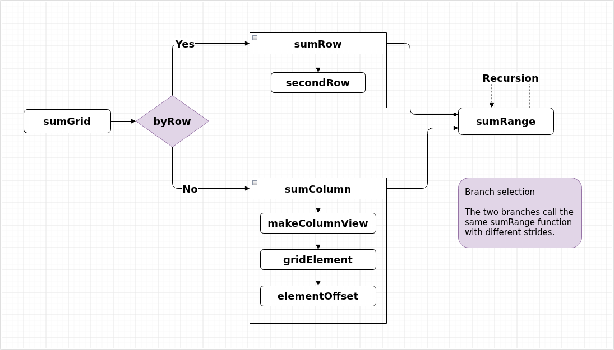
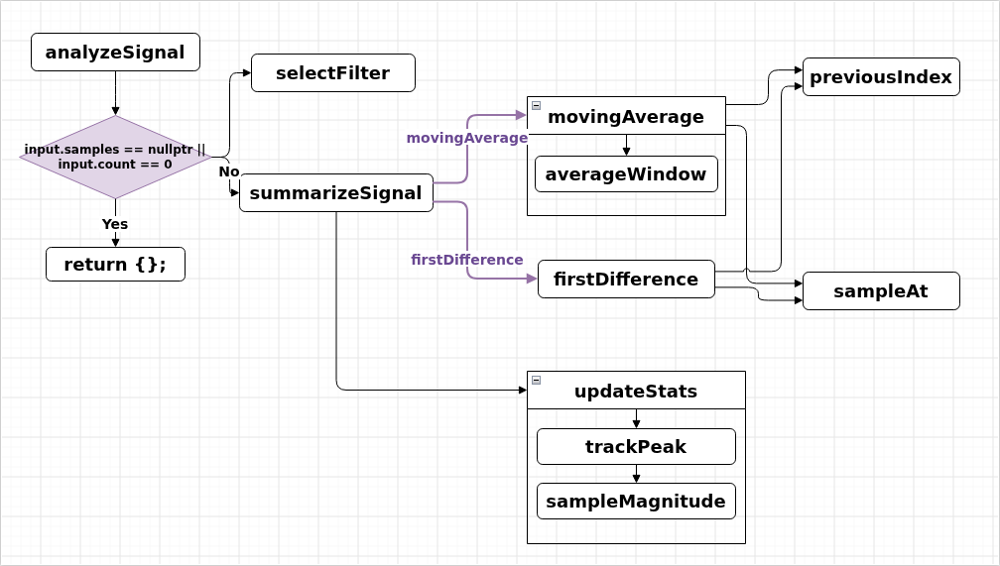
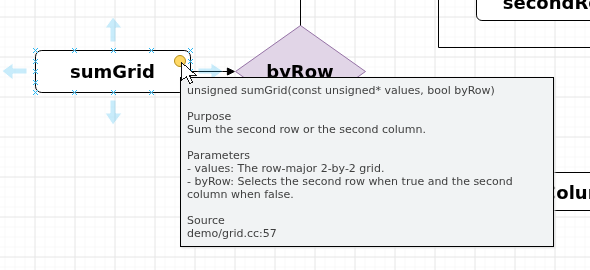
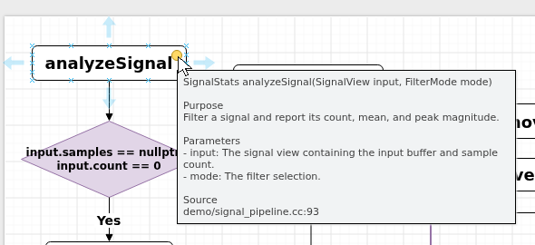

<p align="center">

</p>

<h1 align="center">Map Calls — Generate editable draw.io call graphs</h1>

<p align="center">

</p>

[Examples](#examples) · [Install](#install) · [Quick start](#quick-start)

Map Calls is a Codex skill that traces source calls using the active build configuration. It draws each shared function once and keeps recursive calls visible. In draw.io, you can fold branches independently and inspect function signatures, parameters, and source locations.

## Examples

<table width="100%">
<tr>
<th width="50%" align="center">Grid reduction</th>
<th width="50%" align="center">Signal pipeline</th>
</tr>
<tr>
<td width="50%" valign="top" align="center">

</td>
<td width="50%" valign="top" align="center">

</td>
</tr>
<tr>
<td colspan="2" align="center"><strong>Collapse and expand call branches</strong></td>
</tr>
<tr>
<td width="50%" valign="top" align="center">
<a href="assets/tooltip-preview.png" title="View the animation at full size">

</a>
</td>
<td width="50%" valign="top" align="center">
<a href="assets/signal-pipeline-tooltip.png" title="View the animation at full size">

</a>
</td>
</tr>
<tr>
<td colspan="2" align="center"><strong>Inspect function details on hover</strong><br />Hover over the yellow dot at the upper-right corner of the function node.</td>
</tr>
<tr>
<td width="50%" align="center">
<a href="demo/grid.cc">Source</a> · <a href="assets/shared-kernel.en.drawio">English diagram</a> · <a href="assets/shared-kernel.drawio">Chinese diagram</a>
</td>
<td width="50%" align="center">
<a href="demo/signal_pipeline.cc">Source</a> · <a href="assets/signal-pipeline.en.drawio">English diagram</a> · <a href="assets/signal-pipeline.drawio">Chinese diagram</a>
</td>
</tr>
</table>

## Install

From the root of a checkout, copy the skill into your personal Codex skills directory.

```sh
skill_dir="${CODEX_HOME:-$HOME/.codex}/skills/map-calls"
mkdir -p "$skill_dir"
cp -R SKILL.md LICENSE agents assets demo "$skill_dir/"
```

## Quick start

Open Codex in this repository and choose an example prompt.

### Grid reduction

```text
Use $map-calls to trace calls from sumGrid in demo/grid.cc. Start with sumColumn collapsed and write the diagram to codex/reports/sumGrid.calls.drawio.
```

Open the generated file in draw.io. Expand `sumColumn` to reveal `makeColumnView`, `gridElement`, and `elementOffset`. Collapse it again to hide those three levels while `sumRow` and the shared `sumRange` stay visible. In the included examples, follow the link on `sumRange` to see its call to `readValue`.

### Signal pipeline

```text
Use $map-calls to trace calls from analyzeSignal in demo/signal_pipeline.cc. Start with updateStats collapsed and write the diagram to codex/reports/analyzeSignal.calls.drawio.
```

In draw.io, expand `updateStats` to see how `trackPeak` uses `sampleMagnitude`. The two purple edges from `summarizeSignal` identify the possible targets of the filter function pointer. Hover over the yellow dot at the upper-right corner of the entry node to see its signature, parameters, and source location.

## Use in your own repository

Give Codex a function, module directory, or repository path and a destination directory or `.drawio` filename. You can also specify a maximum trace depth, an initial expansion depth, or branches to collapse. Include the relevant build target or configuration if the call path depends on it.

The diagram uses the language of the request. Chinese prompts produce Chinese labels and tooltips, and English prompts produce English ones. You can explicitly request either language. Function names, signatures, source paths, and condition expressions appear as written in the source.

## License

[MIT License](LICENSE)
